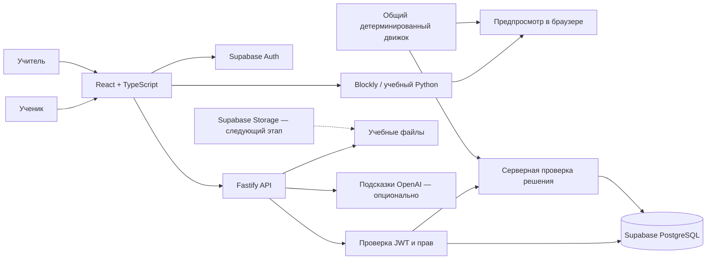

# Архитектура EasyCode AI

Платформа для обучения программированию учеников 3–6 классов. Учитель создаёт класс, разделы и задания; ученик присоединяется по коду, изучает теорию и управляет виртуальной машиной блоками или текстовыми командами.

## Основное решение

Один веб-клиент, один сервер API и управляемые сервисы Supabase. Микросервисы, отдельный сервер исполнения Python и собственный сервер авторизации на первом этапе не нужны.



## Распределение ответственности

| Часть | Технология / расположение | Ответственность |
| --- | --- | --- |
| Интерфейс | React, TypeScript, Vite; `src/` | Каталог, теория, кабинеты, редактор, анимация машины, показ результатов |
| Блочный редактор | Blockly | Перетаскивание команд, сохранение структуры блоков, генерация учебного текста |
| Учебное исполнение | TypeScript; `shared/` | Разбор разрешённого языка, перемещение на клеточном поле, ограничения, результат |
| API | Node.js, Fastify; `server/` | Авторизация, проверка владения классом, создание контента, присоединение, оценивание, выдача файлов |
| Вход и сессии | Supabase Auth | Учётные записи, JWT, восстановление доступа |
| Постоянные данные | Supabase PostgreSQL | Профили, классы, участники, разделы, задания, попытки |
| Защита строк | PostgreSQL RLS | Дополнительное ограничение доступа к данным при обращении к Supabase |
| Файлы | `content/materials/`; позднее Supabase Storage | Подключённые оригиналы DOCX/PPTX; дальнейшая загрузка материалов учителем |
| AI-подсказки | Серверный вызов OpenAI Responses API | Небольшая педагогическая подсказка; не выставляет оценку и не исполняет код |

## Структура проекта

```text
EasyCode/
├── src/                   # Веб-приложение и стили
├── server/                # API, авторизация, доступ к данным
├── shared/                # Общие типы и симуляция
├── scripts/               # Локальный запуск процессов
├── tests/                 # Браузерные сценарии
├── supabase/
│   └── migrations/        # Версионируемая SQL-схема и политики
├── content/
│   └── materials/         # Каталог и восемь исходных материалов
├── docs/
│   ├── ARCHITECTURE.md
│   ├── API.md
│   └── ROADMAP.md
├── .env.example           # Только имена переменных и пустые ключи
└── README.md
```

## Практическая часть

### Страницы уроков и прогресс

Каждая тема имеет маршрут `/learn/topic/:id`. Тексты и закрытые ключи самопроверки хранятся в `content/lessons/index.ts` на стороне API. Публичный ответ урока содержит только вопросы и варианты. Материалы учителя по-прежнему доступны только по прежнему защищённому маршруту скачивания.

`lesson_progress` хранит отметки шагов и лучший результат самопроверки отдельно для каждого пользователя. API берёт пользователя из проверенной сессии, проверяет принадлежность шага уроку и самостоятельно оценивает ответы. Завершение требует всех шагов и успешной самопроверки. Атомарная серверная функция объединяет прочитанные шаги и сохраняет лучший результат при повторных запросах. Самопроверка помогает учиться и не заменяет оценку практического задания.

Для этой функции требуется миграция `202610070001_lesson_progress.sql`. У гостя прогресс локальный; при недоступной миграции интерфейс сообщает об отсутствии облачного сохранения. Локальные ключи разделены по аккаунтам, и гостевые баллы не импортируются как доверенная серверная оценка. Ключи правильных ответов не импортируются в веб-клиент; исходники `content/lessons/` закрыты также для прямой выдачи dev-сервером.

### Симулятор

Публичная точка входа `/` — ознакомительная страница с локальной интерактивной демонстрацией. `/login` и `/register` открывают поверх неё формы входа и регистрации. Учебное приложение загружается отдельно по `/learn`, а `/learn?practice=1` сразу открывает практическую среду. Прямые переходы на эти адреса требуют SPA fallback на `index.html` при размещении статического клиента.

Гость может запускать встроенное тренировочное задание и сохранять черновик в своём браузере. Практическая среда не запрашивает задания, серверную проверку или AI-подсказки без аккаунта: кнопки облачного сохранения и подсказки открывают форму входа. Это не относится к явно включённому локальному деморежиму, где API предоставляет демонстрационного пользователя. Результаты гостевого запуска не становятся оценкой и не записываются в Supabase.

Практика состоит из задания, клеточного поля, исполнителя, редактора и результата проверки. Для первой версии исполнитель — машина: движение по клеткам, повороты, повторения и условие «впереди препятствие». Разделы про электронные компоненты и собственные проекты требуют других сцен и остаются отдельными этапами.

Учитель пока создаёт задание на подготовленной карте. Общая модель `world` и API поддерживают другие карты, но визуальный редактор расположения старта, цели и препятствий остаётся следующим этапом.

Оба способа ввода проходят через один набор разрешённых команд. Blockly генерирует текст учебного языка; текстовый редактор позволяет писать его вручную. Это ограниченное Python-подобное подмножество, а не полноценная среда Python: нет `import`, файловой системы, сети, `eval` и запуска пользовательского кода в Node.js. Поддерживаемый синтаксис перечислен в интерфейсе и контракте движка.

Преобразование блоков в текст одностороннее. Автоматическое восстановление произвольного текста в блоки не предусмотрено. Перед заменой текста редактор должен сохранять или явно учитывать пользовательские изменения.

Проверка проходит в два этапа:

1. Браузер рассчитывает траекторию и показывает движение. Этот результат нужен для обучения, но ему нельзя доверять как оценке.
2. API получает решение, заново загружает условия задания, исполняет тот же движок с лимитами и сохраняет свою оценку. Переданное клиентом поле, цель или сообщение «успех» не заменяют серверные условия.

Движок ограничивает размер входа, вложенность и число исполняемых действий. Выход за поле, столкновение, неподдерживаемая команда и превышение лимита возвращают объяснимую ошибку. Повторный запуск того же решения на том же задании должен давать тот же результат. Точный набор команд, формат поля и лимиты описаны в [контракте API](API.md).

## Модель данных

Главные сущности:

- Профиль пользователя связан с Supabase Auth; роль ученика или учителя хранится отдельно от редактируемых пользователем метаданных.
- Класс принадлежит одному учителю и имеет код присоединения; список классов дополняется фактическим числом участников `member_count`.
- Участие связывает ученика и класс; одна пара не должна дублироваться.
- Раздел принадлежит классу; в нём размещаются теория и практические задания.
- Задание содержит описание, сложность и серверные условия практики.
- Попытка связывает пользователя, задание, отправленное решение и результат серверной проверки. Серверный признак `is_test` отделяет тестовые запуски учителя от ученических попыток; API журнала класса не включает тесты учителя.
- Материал имеет тип, аудиторию и путь к файлу; конспекты учителя недоступны ученику.

Точные таблицы, ограничения и политики находятся в SQL-миграциях. Схема в репозитории не означает, что она уже применена к облачному проекту.

## Границы безопасности

API проверяет токен через Supabase и получает роль из защищённого профиля. Учитель видит только собственные классы и учеников этих классов; ученик — только доступные ему материалы, задания и собственные попытки. Знание идентификатора чужого класса не даёт доступа.

Каталог курса можно просматривать без входа: публичный ответ не содержит конспекты учителя. Загрузка исходных файлов требует авторизации. Учительские материалы добавляются в каталог только после проверки роли; ответ не сохраняется в общем кэше.

Новый пользователь выбирает роль `student` или `teacher` при регистрации. После миграции `202610070002_signup_roles.sql` триггер `auth.users AFTER INSERT` один раз переносит допустимый выбор из регистрационных метаданных в `profiles.role`; неизвестное или отсутствующее значение даёт `student`. Это открытый выбор учебного кабинета, а не подтверждение принадлежности к школе или выдача административных прав.

После создания аккаунта авторитетен только защищённый `profiles.role`: изменение `user_metadata`, выбор другого кабинета при входе или подмена заголовка не повышают права. Вход сверяет выбранную роль с `/api/me`, не выполняя запись роли. Существующие пользователи не переопределяются новой миграцией. Нужная смена роли существующего аккаунта остаётся отдельным административным действием.

`SUPABASE_SERVICE_ROLE_KEY` обходит RLS, поэтому остаётся только на сервере. Каждый использующий его обработчик обязан отдельно проверить роль, владение и членство. RLS — второй уровень защиты, а не замена проверкам API. `OPENAI_API_KEY` тоже никогда не попадает в клиентскую сборку.

Исходные документы не публикуются целиком в общедоступной папке веб-клиента. API выдаёт только файлы из каталога с проверкой аудитории; пользовательский путь не должен превращаться в произвольное чтение файлов сервера. Загрузка новых файлов и конвертация DOCX/PPTX в веб-просмотр пока не реализованы.

Миграция создаёт приватный бакет `course-materials` и ограничительную политику, закрывающую прямые операции `anon` и `authenticated` с этим бакетом даже при других разрешающих политиках Storage. Текущие материалы ещё не перенесены в него. Будущий серверный маршрут загрузки или временных ссылок обязан сам проверить роль и аудиторию.

## Режимы работы

### Локальная демонстрация

`DEMO_MODE=true` позволяет проверить интерфейс и сценарии без аккаунтов и ключей. Данные хранятся в памяти процесса API и исчезают после его перезапуска. Демо-переключение ролей — инструмент проверки интерфейса, а не авторизация. Такой режим предназначен только для локальной разработки и не должен быть доступен из интернета.

### Подключённый Supabase

Требуются реальный проект Supabase, применённые миграции, заполненные переменные окружения и отключённый деморежим. У каждого пользователя свой аккаунт; API принимает его токен, а результаты сохраняются в PostgreSQL.

Пустые ключи не подменяются фиктивными секретами. Отсутствие настроек должно приводить к понятному сообщению; отсутствие ключа OpenAI не блокирует обычное обучение и серверную проверку решений.

## Серверы и развёртывание

Локально Vite обслуживает веб-интерфейс на `http://localhost:5173`, API — на `http://localhost:3001`. Веб-клиент обращается к `/api`; в разработке Vite перенаправляет эти запросы на API.

`npm run dev` запускает оба процесса через `scripts/dev.mjs`. Сборка создаёт клиент в `dist/` и API в `build/server/index.js`. Команда `npm start` выполняется из корня проекта; папка `content/materials/` нужна серверу во время работы и должна переноситься вместе с ним.

Для публикации нужны статический хостинг собранного клиента, Node.js-процесс API и Supabase. Удобная целевая схема — один HTTPS-домен: `/` направлен на клиент, `/api` — на API через обратный прокси. Сам API не обязан быть отдельным публичным доменом.

Перед публикацией необходимо настроить HTTPS, точный разрешённый origin, URL возврата Supabase Auth, секреты окружения, резервные копии, мониторинг, ограничения запросов и выдачу ролей. Локальная сборка не является развёртыванием. Эта работа не создаёт оплачиваемые облачные ресурсы и не публикует приложение автоматически.

## Дизайн

Визуальный ориентир — [React Bits](https://reactbits.dev/): тёмный фон, фиксированная навигация, тонкие границы, скруглённые карточки и фиолетовые акценты. Название, содержание и учебные сценарии принадлежат EasyCode; каталог чужих компонентов не переносится как содержание курса.

| Назначение | Цвет |
| --- | --- |
| Основной фон | `#120f17` |
| Поверхность карточки | `#1b1722` |
| Наведение | `#373044` |
| Граница | `#2f293a` |
| Основной акцент | `#a855f7` |
| Вторичный акцент | `#b497cf` |
| Основной текст | `#ffffff` / `#f5f5f5` |
| Вторичный текст | `#aaaaaa` |

Анимация помогает проследить выполнение алгоритма. Интерфейс должен учитывать `prefers-reduced-motion`, клавиатурную навигацию и небольшие экраны.

## Что ещё не означает готовность к школе

До работы с настоящими учениками требуются проверки RLS на разных аккаунтах, сценарии восстановления доступа, контроль персональных данных несовершеннолетних, согласованный порядок доступа школы и родителей, резервное копирование и пилот с учителем. Качество AI-подсказок оценивается отдельно; модель не должна запрашивать личные данные ребёнка или заменять учителя.
